# Meta Muse Vision AI
### Voice-Powered Wearable Visual Intelligence

**Meta AI Global Developer Hackathon 2026**

## Project Overview

**Meta Muse Vision AI** is an affordable, hands-free wearable AI vision system that combines a custom-designed, 3D-printed headset, an 8MP autofocus USB camera, and an Android application developed using C# and .NET MAUI 10.

I personally designed and modeled the wearable headset in **Blender**, 3D-printed the physical prototype, assembled the hardware, developed the Android application, and integrated **Meta's Muse Spark multimodal AI**.

The system enables users to capture and interpret real-world visual information through voice commands, extending beyond conventional barcode scanning into AI-assisted workplace tasks.

## Project Gallery & 3D Design Files

Explore the **original headset I designed in Blender and 3D-printed**, along with screenshots of the .NET MAUI Android application. Click any image to see it at full size.

### Download the 3D Models

- **[Blender 3D Headset Design (.blend)](MetaVisionAI_MAUIProject/3DMetaVisionAIHeadsetModel.blend)** — original editable model for Blender.
- **[3D Printing File (.stl)](MetaVisionAI_MAUIProject/3DMetaVisionAIPrintFile.stl)** — printable headset geometry; GitHub can preview the model.
- **[Project Report (PDF)](Meta%20Muse%20Vision%20AI%20Document.pdf)** — detailed project documentation.

### Headset Design — Blender Images

| Preview 1 | Preview 2 |
| :---: | :---: |
| [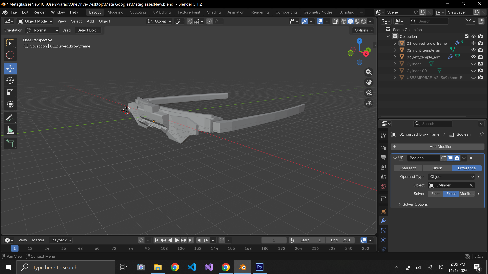](MetaVisionAI_MAUIProject/MetaHeadset_BlenderPic1.png) | [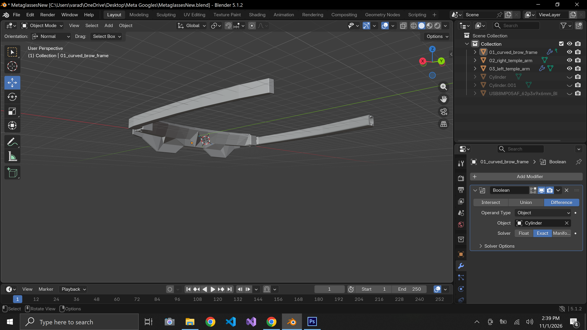](MetaVisionAI_MAUIProject/MetaHeadset_BlenderPic2.png) |
| [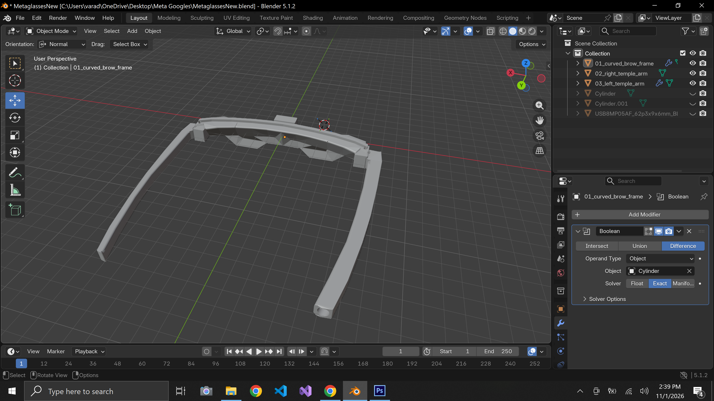](MetaVisionAI_MAUIProject/MetaHeadset_BlenderPic3.png) | [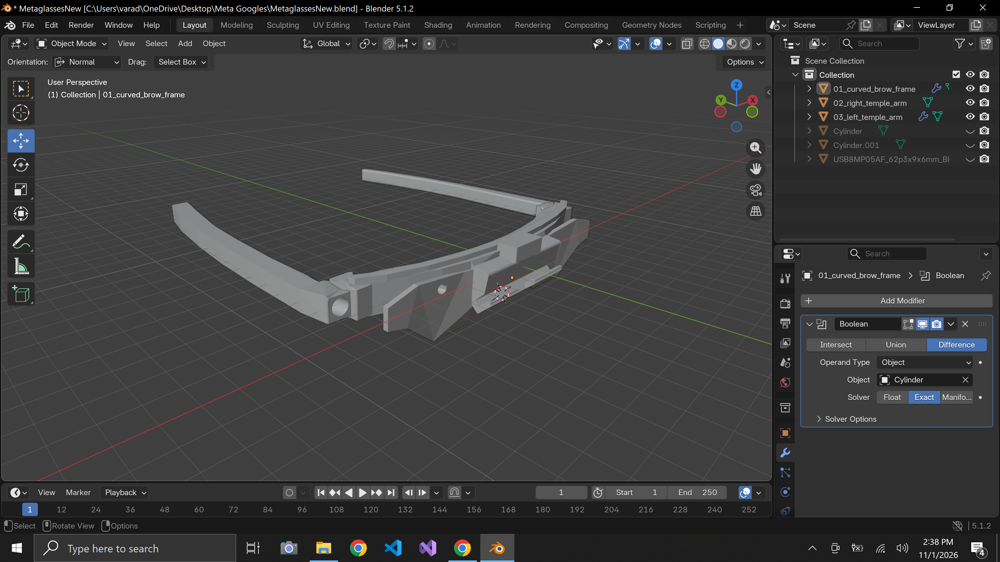](MetaVisionAI_MAUIProject/MetaHeadset_BlenderPic4.png) |

### Android App — Screenshots

| Preview 1 | Preview 2 | Preview 3 |
| :---: | :---: | :---: |
| [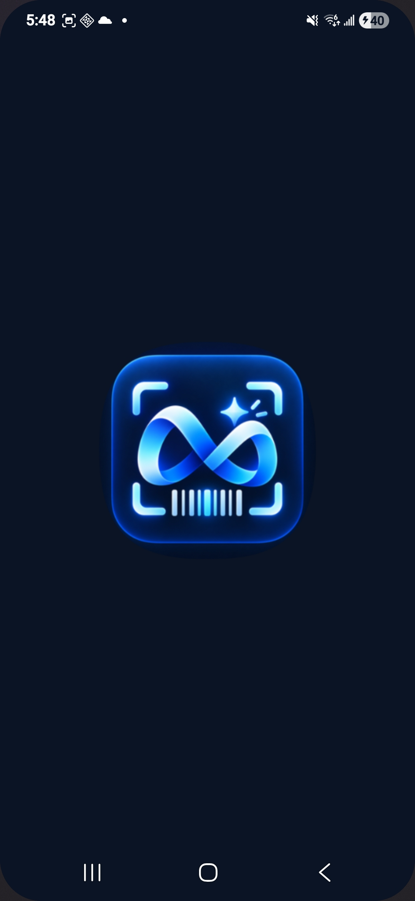](MetaVisionAI_MAUIProject/MetaVisionAI_App_Pic1.jpg) | [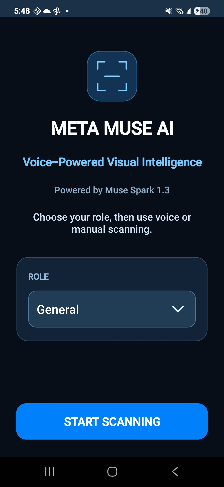](MetaVisionAI_MAUIProject/MetaVisionAI_App_Pic2.jpg) | [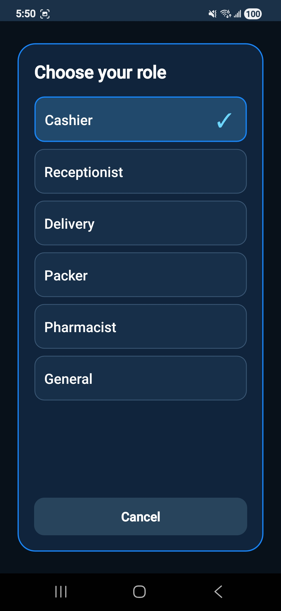](MetaVisionAI_MAUIProject/MetaVisionAI_App_Pic3.jpg) |
| [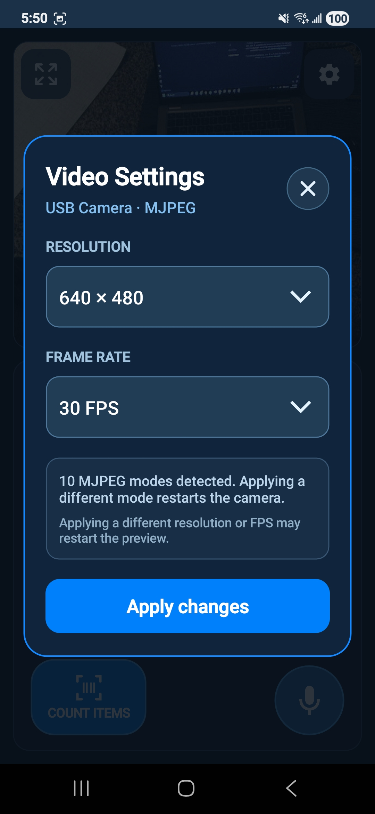](MetaVisionAI_MAUIProject/MetaVisionAI_App_Pic4.jpg) | [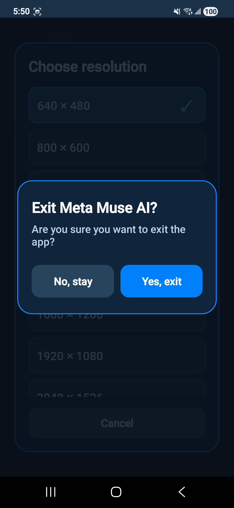](MetaVisionAI_MAUIProject/MetaVisionAI_App_Pic5.jpg) | [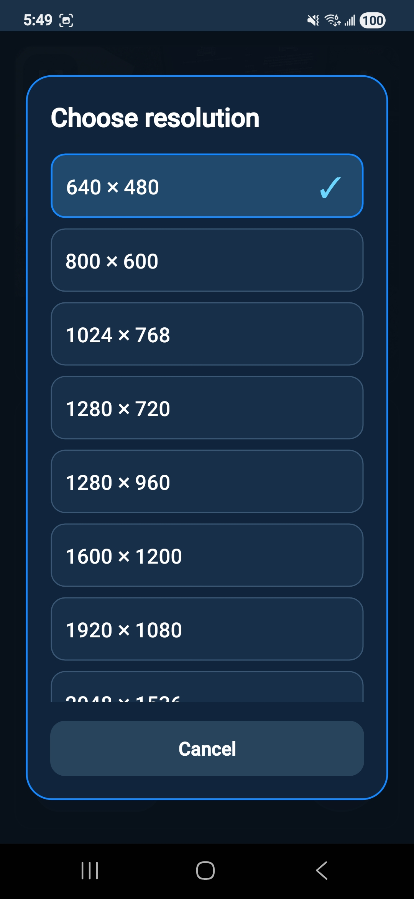](MetaVisionAI_MAUIProject/MetaVisionAI_App_Pic6.jpg) |
| [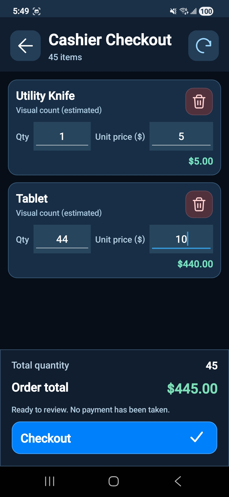](MetaVisionAI_MAUIProject/MetaVisionAI_App_Pic7.jpg) | [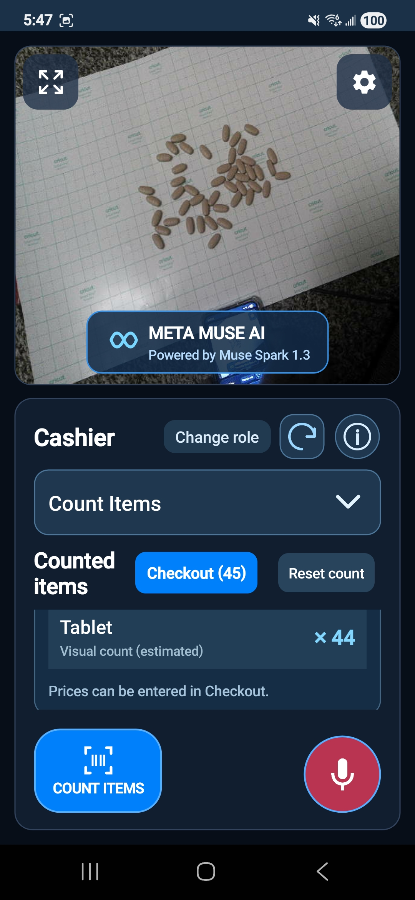](MetaVisionAI_MAUIProject/MetaVisionAI_App_Pic8.jpg) | [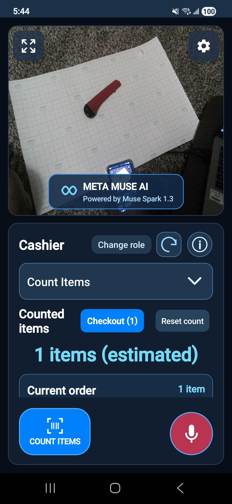](MetaVisionAI_MAUIProject/MetaVisionAI_App_Pic9.jpg) |

The files above are from this project's own repository. The **current application is Android-only**; the Blender and STL files document the physical headset design.

## Problem Statement

Despite advances in artificial intelligence, many industries still depend on traditional handheld barcode scanners and specialized scanning equipment.

These devices can involve additional hardware costs, charging requirements, Bluetooth or Wi-Fi pairing, and limited functionality beyond barcode reading.

Workers also frequently need to use their hands to operate scanning equipment, reducing convenience during repetitive activities.

## Our Solution

Meta Muse Vision AI introduces an affordable, USB-connected wearable headset that transforms a standard camera into a hands-free AI-powered visual assistant.

The camera connects directly to an Android smartphone through USB-C, using the phone for power and processing.

By integrating Meta Muse Spark, the application can interpret captured images and return structured information for different workplace tasks.

## Key Features

- **Hands-Free Operation:** Wearable camera positioned for convenient visual capture.
- **Voice-Activated Scanning:** Trigger scanning using the voice command "Scan".
- **Barcode and QR Code Recognition:** Read barcode information from camera images.
- **AI-Powered Object Counting:** Identify and count visible items.
- **Product and Label Reading:** Extract useful information from product labels and packaging.
- **Currency Counting:** Interpret visible currency denominations and calculate totals.
- **Delivery Assistance:** Extract shipment addresses and support location-based verification.
- **Role-Based Workflows:** Dedicated application workflows for cashiers, delivery workers, packers, pharmacists, receptionists, and general users.
- **Cart and Checkout:** Manage scanned items, edit quantities and prices, and calculate totals.
- **USB Plug-and-Play Design:** No separate camera battery, Bluetooth pairing, or camera Wi-Fi connection required.

## Technology Stack

- **Multimodal AI:** Meta Muse Spark 1.3
- **Application Development:** C# / .NET MAUI 10
- **Current Application Platform:** Android
- **Camera:** USB8MP05AF 8MP Autofocus UVC Camera
- **Camera Integration:** Android USB Host, UVC, and native JNI interoperability
- **3D Modeling:** Blender
- **Hardware Prototyping:** 3D Printing
- **Connectivity:** USB-C
- **User Interaction:** Voice Commands and Touch Controls

## Hardware Design and 3D Printing

A major part of this project is the **original wearable headset designed and built from scratch**.

The development process included:

1. Designing the wearable headset and its components in Blender.
2. Modeling the camera mounting structure, front frame, foldable side supports, and cable routing.
3. Creating 3D-printable components and producing the physical prototype.
4. Mounting the USB autofocus camera onto the printed headset.
5. Connecting the headset directly to an Android smartphone through USB-C.
6. Developing and integrating the Android application with Meta's multimodal AI capabilities.

The headset uses a lightweight frame with a camera angled downward to support hands-free scanning of objects held in front of the wearer.

### Estimated Prototype Hardware Cost

| Component | Estimated Cost |
|---|---:|
| Custom 3D-printed headset | $10 |
| USB autofocus camera | $30 |
| USB cable and connectors | $5 |
| **Total** | **Approximately $45–$50** |

*These figures are prototype component estimates, excluding the smartphone, development labor, testing, and commercial manufacturing costs.*

## Why Meta Muse Spark AI?

Traditional barcode scanners primarily decode machine-readable codes. Meta's multimodal AI enables broader interpretation of real-world visual information.

Muse Spark is integrated into the Android application to analyze captured images and support tasks such as object counting, label interpretation, currency recognition, and extraction of shipment information.

By combining visual understanding with voice commands, the same wearable device can support multiple workflows without requiring specialized scanning hardware for each task.

**Meta's multimodal AI is the intelligence that extends our wearable camera beyond conventional barcode scanning.**

## Real-World Applications

- **Retail and Cashiers:** Scan products, count items, and manage checkout workflows.
- **Warehousing:** Support hands-free inventory and package counting.
- **Delivery and Logistics:** Read shipment information and assist with delivery address verification.
- **Pharmacies:** Assist with counting items and reading product information.
- **Reception and Administrative Work:** Read and organize visual information.
- **Manufacturing:** Support visual inspection and item counting.
- **General Use:** Identify and count everyday objects through voice commands.

## Platform Compatibility

The current Meta Muse Vision AI application is developed for **Android using .NET MAUI 10**.

The USB UVC headset hardware is designed around standard camera connectivity and may also be usable with compatible Windows, macOS, and other USB-C devices through appropriate software.

Cross-platform application deployment and device compatibility require additional development and testing.

## Project Status

Meta Muse Vision AI is a functional research prototype developed for the **Meta AI Global Developer Hackathon 2026**.

The project demonstrates an end-to-end approach to wearable AI development, combining original industrial design, 3D printing, electronics integration, mobile application development, and multimodal AI.

Scanning accuracy, device compatibility, and individual AI-assisted workflows require further validation before commercial use.

## Future Enhancements

- Improve camera focus and recognition reliability.
- Optimize image processing and AI response times.
- Expand support for compatible mobile and desktop platforms.
- Refine the headset design for comfort, durability, and manufacturability.
- Expand industrial workflow integration.

## Project Goal

**Make hands-free visual intelligence affordable, accessible, and practical for everyday work by combining original 3D-printed wearable hardware with Meta's multimodal AI.**

## Beyond the Hackathon — My Journey and Future Vision

**Winning a hackathon is an achievement, but turning an idea into something meaningful is a victory in itself.**

For me, Meta Muse Vision AI represents more than a competition entry. It is the result of taking an idea from imagination to physical reality—from personally designing a wearable headset in Blender and 3D-printing the prototype to developing an Android application and integrating Meta's multimodal AI.

Whether this project is selected as a finalist or wins an award, **my journey will not stop with the hackathon**. I plan to present this innovation to my company's leadership and explore opportunities to further develop and implement it in real-world business operations.

I believe the true value of innovation lies not only in recognition, but in its potential to solve practical problems, improve productivity, and make technology more accessible.

I sincerely thank **Meta and Cerebral Valley** for organizing this hackathon and providing a platform that encouraged me to experiment, learn, design, build, and bring a meaningful idea to life.

This opportunity has reinforced my belief that innovation does not always require expensive equipment or large teams. Sometimes, curiosity, determination, affordable hardware, and the right AI technology are enough to create something with real potential.

**The hackathon may end, but the innovation continues.**

**Winning would be an honor. Creating something meaningful that can make a difference is already an achievement.**

---

## Android APK — Download (v1.0.0)

The Android prototype APK is available as a **GitHub pre-release** for testing on compatible Android devices. It has not been validated for production use.

- **[Download Android APK](https://github.com/varadacharisuresh/MetaMuseVisionAI/releases/download/v1.0.0/MetaMuseVisionAI_Android.apk)**
- [View release notes](https://github.com/varadacharisuresh/MetaMuseVisionAI/releases/tag/v1.0.0)

The current application targets Android; a compatible USB UVC camera and Android USB Host support are required for headset functionality. Installation and device compatibility should be verified before broader distribution.

## Project Links & Developer Profile

### YouTube – Project Demonstration

Watch the Meta Muse Vision AI prototype and demonstration.

https://youtu.be/AcdOGsPkFgk

### GitHub – Source Code

Explore the .NET MAUI Android application, UVC camera integration, and project source code.

https://github.com/varadacharisuresh/MetaMuseVisionAI

### LinkedIn – Developer Profile

**Suresh Kumar Varadachari**

https://www.linkedin.com/in/suresh-kumar-varadachari-0a9b9129/

---

**Developed for Meta AI Global Developer Hackathon 2026**

*Original Headset Design | Blender 3D Modeling | 3D Printing | USB Camera Integration | .NET MAUI Android Development | Meta Muse Spark AI*

**“The true success of innovation is not just winning recognition, but creating something that continues to make an impact long after the competition ends.”**
