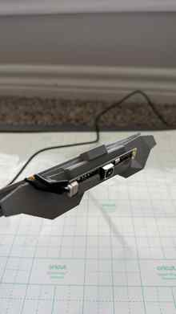
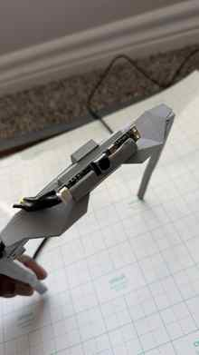
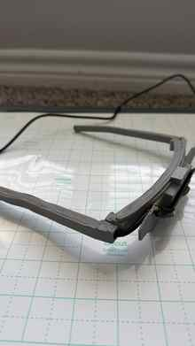
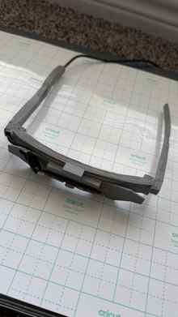
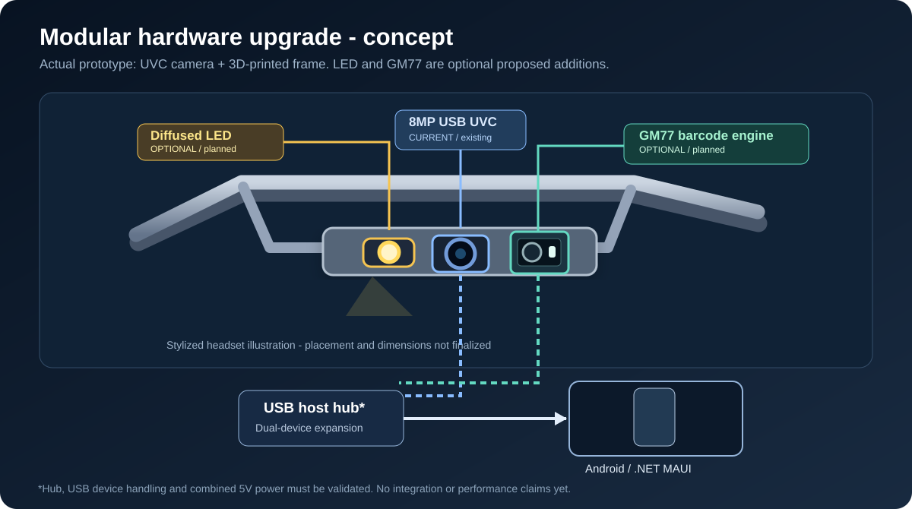
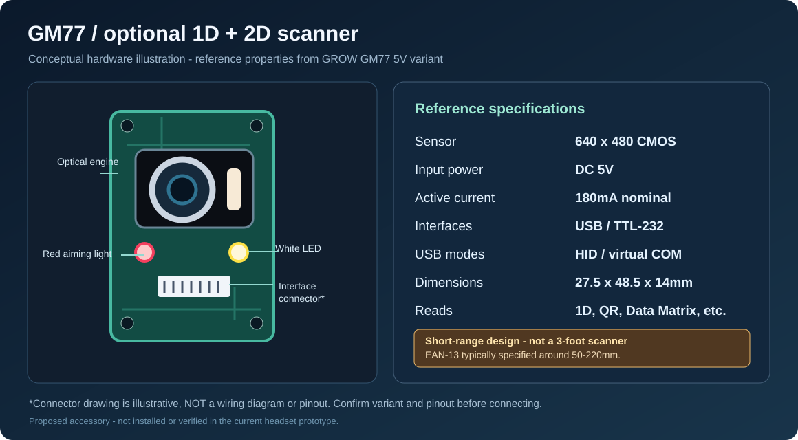
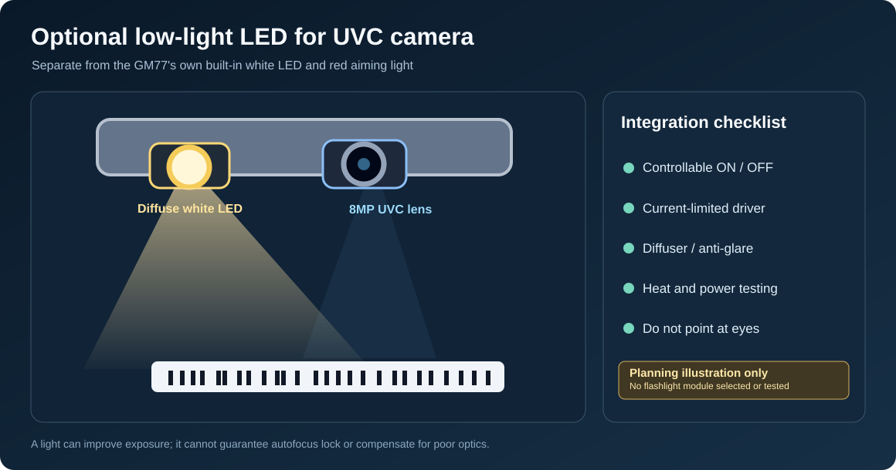

# Meta Muse Vision AI
### Voice-Powered Wearable Visual Intelligence

**Meta AI Global Developer Hackathon 2026**

## For Hackathon Judges — Project at a Glance

**In one sentence:** Meta Muse Vision AI combines my own **Blender-designed, 3D-printed headset**, a **USB-powered 8MP autofocus camera**, a **C#/.NET MAUI 10 Android app**, and **Meta Muse Spark AI** to explore hands-free barcode scanning and visual assistance.

**The problem:** Handheld scanners occupy workers' hands, while dedicated wearable scanning equipment can add cost and pairing/charging complexity. My goal is a low-cost, plug-in headset that uses the phone for power and processing.

### Quick Judge Tour

| Start here | Link | What to review |
| --- | --- | --- |
| **1. Demo video** | **[Watch the project demo](https://youtu.be/AcdOGsPkFgk)** | Physical headset and Android demonstration |
| **2. Real prototype** | [Original 3D-printed photos](MetaVisionAI_MAUIProject/3DPrintedPrototype) | Actual camera mount, printed frame and cable routing |
| **3. Android app** | [Application screenshots](#android-app--screenshots) · [MAUI source code](MetaVisionAI_MAUIProject/USB8MP05AF_MAUI/UvcViewer) | User interface and USB camera integration |
| **4. 3D design** | [Blender model](MetaVisionAI_MAUIProject/3DMetaVisionAIHeadsetModel.blend) · [Printable STL](MetaVisionAI_MAUIProject/3DMetaVisionAIPrintFile.stl) | Original editable and printable headset design |
| **5. Documentation** | [Project report (PDF)](Meta%20Muse%20Vision%20AI%20Document.pdf) · [How it works](#how-the-system-works) | Features, architecture and use cases |
| **6. Try the build** | [Android prototype APK (v1.0.0)](https://github.com/varadacharisuresh/MetaMuseVisionAI/releases/download/v1.0.0/MetaMuseVisionAI_Android.apk) · [Requirements](#developer-setup--requirements) | Testing pre-release; compatible Android phone and UVC hardware needed |

### Real Hardware and App — Quick Preview

| My 3D-printed headset (original photo) | Android application |
| :---: | :---: |
| [](MetaVisionAI_MAUIProject/3DPrintedPrototype/3d-printed-headset-camera-front.jpg) | [](MetaVisionAI_MAUIProject/MetaVisionAI_App_Pic1.jpg) |

**What's already built:** Physical 3D-printed frame, mounted USB UVC camera, Android prototype and Meta Muse Spark integration. The base hardware estimate is about **$45–$50** (excluding the phone, labor and manufacturing).

**What remains future work:** Extended reliability testing, production refinement, cross-platform support, and the [optional LED + GM77 scanner concept](docs/hardware/optional-led-and-gm77.md). Those accessories are **not part of the demonstrated build**.

**Important for reviewers:** Current app targets Android. The downloadable APK is a test pre-release and is not certified; working Meta API credentials are intentionally excluded from the public repository.

## Project Overview

**Meta Muse Vision AI** is an affordable, hands-free wearable AI vision system that combines a custom-designed, 3D-printed headset, an 8MP autofocus USB camera, and an Android application developed using C# and .NET MAUI 10.

I personally designed and modeled the wearable headset in **Blender**, 3D-printed the physical prototype, assembled the hardware, developed the Android application, and integrated **Meta's Muse Spark multimodal AI**.

The system enables users to capture and interpret real-world visual information through voice commands, extending beyond conventional barcode scanning into AI-assisted workplace tasks.

## Project Gallery & 3D Design Files

Explore the **original headset I designed in Blender and 3D-printed**, along with screenshots of the .NET MAUI Android application. Click any image to see it at full size.

### Download the 3D Models

- **[Blender 3D Headset Design (.blend)](MetaVisionAI_MAUIProject/3DMetaVisionAIHeadsetModel.blend)** — original editable model for Blender.
- **[3D Printing File (.stl)](MetaVisionAI_MAUIProject/3DMetaVisionAIPrintFile.stl)** — printable headset geometry; GitHub can preview the model.
- **[Project Report (PDF)](Meta%20Muse%20Vision%20AI%20Document.pdf)** — detailed project documentation.

### Headset Design — Blender Images

| Preview 1 | Preview 2 |
| :---: | :---: |
| [](MetaVisionAI_MAUIProject/MetaHeadset_BlenderPic1.png) | [](MetaVisionAI_MAUIProject/MetaHeadset_BlenderPic2.png) |
| [](MetaVisionAI_MAUIProject/MetaHeadset_BlenderPic3.png) | [](MetaVisionAI_MAUIProject/MetaHeadset_BlenderPic4.png) |


### 3D-Printed Prototype — Original Photos

These photographs show the **physical headset prototype I designed in Blender, 3D-printed, and assembled**, including the printed frame, USB autofocus camera mount, and cable routing. They are photographs of the actual prototype, not 3D renders or AI-generated images.

| Camera mount — side view | Camera module — front view |
| :---: | :---: |
| [](MetaVisionAI_MAUIProject/3DPrintedPrototype/3d-printed-headset-camera-side.jpg) | [](MetaVisionAI_MAUIProject/3DPrintedPrototype/3d-printed-headset-camera-front.jpg) |
| **3D-printed frame and folding arms** | **Top view and cable routing** |
| [](MetaVisionAI_MAUIProject/3DPrintedPrototype/3d-printed-headset-frame.jpg) | [](MetaVisionAI_MAUIProject/3DPrintedPrototype/3d-printed-headset-top-view.jpg) |

### Android App — Screenshots

| Preview 1 | Preview 2 | Preview 3 |
| :---: | :---: | :---: |
| [](MetaVisionAI_MAUIProject/MetaVisionAI_App_Pic1.jpg) | [](MetaVisionAI_MAUIProject/MetaVisionAI_App_Pic2.jpg) | [](MetaVisionAI_MAUIProject/MetaVisionAI_App_Pic3.jpg) |
| [](MetaVisionAI_MAUIProject/MetaVisionAI_App_Pic4.jpg) | [](MetaVisionAI_MAUIProject/MetaVisionAI_App_Pic5.jpg) | [](MetaVisionAI_MAUIProject/MetaVisionAI_App_Pic6.jpg) |
| [](MetaVisionAI_MAUIProject/MetaVisionAI_App_Pic7.jpg) | [](MetaVisionAI_MAUIProject/MetaVisionAI_App_Pic8.jpg) | [](MetaVisionAI_MAUIProject/MetaVisionAI_App_Pic9.jpg) |

The files above are from this project's own repository. The **current application is Android-only**; the Blender and STL files document the physical headset design.

## Problem Statement

Despite advances in artificial intelligence, many industries still depend on traditional handheld barcode scanners and specialized scanning equipment.

These devices can involve additional hardware costs, charging requirements, Bluetooth or Wi-Fi pairing, and limited functionality beyond barcode reading.

Workers also frequently need to use their hands to operate scanning equipment, reducing convenience during repetitive activities.

## Our Solution

Meta Muse Vision AI introduces an affordable, USB-connected wearable headset that transforms a standard camera into a hands-free AI-powered visual assistant.

The camera connects directly to an Android smartphone through USB-C, using the phone for power and processing.

By integrating Meta Muse Spark, the application can interpret captured images and return structured information for different workplace tasks.

## Key Features

- **Hands-Free Operation:** Wearable camera positioned for convenient visual capture.
- **Voice-Activated Scanning:** Trigger scanning using the voice command "Scan".
- **Barcode and QR Code Recognition:** Read barcode information from camera images.
- **AI-Powered Object Counting:** Identify and count visible items.
- **Product and Label Reading:** Extract useful information from product labels and packaging.
- **Currency Counting:** Interpret visible currency denominations and calculate totals.
- **Delivery Assistance:** Extract shipment addresses and support location-based verification.
- **Role-Based Workflows:** Dedicated application workflows for cashiers, delivery workers, packers, pharmacists, receptionists, and general users.
- **Cart and Checkout:** Manage scanned items, edit quantities and prices, and calculate totals.
- **USB Plug-and-Play Design:** No separate camera battery, Bluetooth pairing, or camera Wi-Fi connection required.

## Technology Stack

- **Multimodal AI:** Meta Muse Spark 1.3
- **Application Development:** C# / .NET MAUI 10
- **Current Application Platform:** Android
- **Camera:** USB8MP05AF 8MP Autofocus UVC Camera
- **Camera Integration:** Android USB Host, UVC, and native JNI interoperability
- **3D Modeling:** Blender
- **Hardware Prototyping:** 3D Printing
- **Connectivity:** USB-C
- **User Interaction:** Voice Commands and Touch Controls

## Hardware Design and 3D Printing

A major part of this project is the **original wearable headset designed and built from scratch**.

The development process included:

1. Designing the wearable headset and its components in Blender.
2. Modeling the camera mounting structure, front frame, foldable side supports, and cable routing.
3. Creating 3D-printable components and producing the physical prototype.
4. Mounting the USB autofocus camera onto the printed headset.
5. Connecting the headset directly to an Android smartphone through USB-C.
6. Developing and integrating the Android application with Meta's multimodal AI capabilities.

The headset uses a lightweight frame with a camera angled downward to support hands-free scanning of objects held in front of the wearer.

### Estimated Prototype Hardware Cost

| Component | Estimated Cost |
|---|---:|
| Custom 3D-printed headset | $10 |
| USB autofocus camera | $30 |
| USB cable and connectors | $5 |
| **Total** | **Approximately $45–$50** |

*These figures are prototype component estimates, excluding the smartphone, development labor, testing, and commercial manufacturing costs.*


## Future Hardware Options — LED Light and GM77 Scanner

> **Planned enhancements only.** The currently demonstrated headset uses the existing 8MP autofocus USB UVC camera. The LED module and GM77 have **not** been integrated into the released hardware, Android app, or hackathon demo.



| Optional GM77 USB/UART barcode scanner | Optional diffused LED for the existing UVC camera |
| :---: | :---: |
|  |  |
| 640 × 480 CMOS, 5V, ~180mA operating current. Supports 1D/2D barcode decoding over short distances. | Proposed separate illumination to improve capture in low light; it requires a safe driver, power budget and glare testing. |

The **GM77 already includes its own white illumination LED and red aiming LED**. A separate flashlight would serve the existing 8MP camera's broader vision tasks. The GM77's typical specified EAN-13 range is about **50–220mm**, so it is **not** a 3-foot barcode-scanning replacement. USB hub support, power draw, Android HID/serial integration and changes to the 3D-printed mount remain to be tested. None of these additions are included in the current ~$45–$50 base prototype estimate.

**[Read the hardware design, module specifications, interface options, reference links and test plan](docs/hardware/optional-led-and-gm77.md).** The images above are original *concept illustrations*, not photographs of installed parts. For photographs and exact details of the GM77 module, see the [manufacturer's product page](https://en.hzgrow.com/product/186.html).

## Why Meta Muse Spark AI?

Traditional barcode scanners primarily decode machine-readable codes. Meta's multimodal AI enables broader interpretation of real-world visual information.

Muse Spark is integrated into the Android application to analyze captured images and support tasks such as object counting, label interpretation, currency recognition, and extraction of shipment information.

By combining visual understanding with voice commands, the same wearable device can support multiple workflows without requiring specialized scanning hardware for each task.

**Meta's multimodal AI is the intelligence that extends our wearable camera beyond conventional barcode scanning.**

## Real-World Applications

- **Retail and Cashiers:** Scan products, count items, and manage checkout workflows.
- **Warehousing:** Support hands-free inventory and package counting.
- **Delivery and Logistics:** Read shipment information and assist with delivery address verification.
- **Pharmacies:** Assist with counting items and reading product information.
- **Reception and Administrative Work:** Read and organize visual information.
- **Manufacturing:** Support visual inspection and item counting.
- **General Use:** Identify and count everyday objects through voice commands.

## Platform Compatibility

The current Meta Muse Vision AI application is developed for **Android using .NET MAUI 10**.

The USB UVC headset hardware is designed around standard camera connectivity and may also be usable with compatible Windows, macOS, and other USB-C devices through appropriate software.

Cross-platform application deployment and device compatibility require additional development and testing.

## Why We Chose .NET MAUI — Cross-Platform Vision

I chose **C# and .NET MAUI** to build Meta Muse Vision AI with a **shared application codebase** that can be extended to **Android, iOS, Windows, and macOS (through Mac Catalyst)**. This lets us reuse much of the user interface, role-based workflows, and Meta Muse Spark integration rather than developing four separate applications.

The same **USB UVC headset concept** could be paired with compatible phones, tablets, and computers, making the hardware potentially reusable across platforms instead of being tied to one device.

**Current implementation:** The working prototype targets **Android**, using Android USB Host and JNI for the UVC camera. Supporting **iOS, Windows, or macOS** will require platform-specific camera integration, permissions, hardware compatibility checks, and testing; cross-platform support is a **development goal**, not a feature already delivered.

## How the System Works

1. The custom **Blender-designed, 3D-printed headset** positions an autofocus USB UVC camera for hands-free capture.
2. A compatible Android phone powers the camera via USB-C and shows the live preview through Android USB Host and JNI integration.
3. The user selects a role and task, then initiates capture using the **"Scan"** voice command or a manual control.
4. The application sends a captured image to **Meta Muse Spark 1.3** for task-specific visual interpretation and structured responses.
5. The Android app presents the result and, where applicable, adds items to the cashier or pharmacy workflow.

This is an **image-capture-and-analysis prototype**, not a claim of continuous real-time video inference. AI outputs require human verification, especially for prices, currency, addresses, or pharmacy-related information.

## Developer Setup & Requirements

**Hardware:** Compatible Android phone with USB Host/OTG support (64-bit ARM recommended), USB8MP05AF UVC camera, and suitable USB-C/OTG cable or adapter. The camera draws power from the phone; compatibility and power delivery vary by device.

**Software:** Visual Studio with the .NET 10 MAUI Android workload, Android SDK/build tools, and internet access for NuGet/Maven dependencies. Current source targets `net10.0-android`; **iOS, Windows, and macOS builds are future work**.

**Source location:** `MetaVisionAI_MAUIProject/USB8MP05AF_MAUI/UvcViewer.sln`

1. Clone/download this repository and open the solution in Visual Studio.
2. Restore the NuGet and Android/Maven dependencies.
3. Select the **Android** target, build the project, and deploy to a compatible Android device.
4. Approve microphone/camera and USB-device access when prompted, connect the headset, and test the supported workflows.

For a local **debug test APK**, from the `UvcViewer` project directory:

```cmd
dotnet build UvcViewer.csproj -f net10.0-android -c Debug -t:SignAndroidPackage -p:AndroidPackageFormats=apk -p:EmbedAssembliesIntoApk=true -p:AndroidKeyStore=false
```

This uses Android debug signing for testing. **It is not a production release-signing process.** See the [published APK pre-release](https://github.com/varadacharisuresh/MetaMuseVisionAI/releases/tag/v1.0.0) for the uploaded test build.

### Meta AI Configuration & Security

The committed `MuseDemoConfiguration.cs` intentionally has an **empty API key**. It demonstrates where the development configuration is referenced; the AI requests **will not work from a fresh checkout without valid credentials and access**.

- **Never commit, publish, or share real API keys**, and never distribute an APK with a private key embedded in it.
- For a production or publicly distributed version, route authenticated Meta API calls through a **secure backend**, not a credential embedded in the mobile application.
- This public repository does not include credentials, a hosted backend, or evidence that every device can install and execute the APK.

### Prototype Limitations

- The project targets **Android** today. Cross-platform .NET MAUI support requires platform-specific USB camera integration and validation.
- Recognition accuracy depends on camera focus, lighting, distance, image quality, network availability, and AI output consistency.
- Price values may be **demonstration values** unless extracted from an image; they are not authoritative retail prices.
- This research prototype is **not certified** for safety-critical, financial, or clinical decisions.
- The native USB camera libraries are packaged for **ARM64 Android**; other architectures are not assured.
- The public download is a **pre-release**. Build success or hosting on GitHub does not by itself verify installation on every Android device.

## Third-Party Components & Licensing

This repository incorporates third-party Android UVC and .NET dependencies. Each third-party component retains its own licensing and attribution requirements. No project-wide license has been specified in this repository; its public availability should not be treated as a blanket permission to redistribute all source, designs, or binaries.

## Project Status

Meta Muse Vision AI is a functional research prototype developed for the **Meta AI Global Developer Hackathon 2026**.

The project demonstrates an end-to-end approach to wearable AI development, combining original industrial design, 3D printing, electronics integration, mobile application development, and multimodal AI.

Scanning accuracy, device compatibility, and individual AI-assisted workflows require further validation before commercial use.

## Future Enhancements

- Improve camera focus and recognition reliability.
- Optimize image processing and AI response times.
- Expand support for compatible mobile and desktop platforms.
- Refine the headset design for comfort, durability, and manufacturability.
- Expand industrial workflow integration.

## Project Goal

**Make hands-free visual intelligence affordable, accessible, and practical for everyday work by combining original 3D-printed wearable hardware with Meta's multimodal AI.**

## Beyond the Hackathon — My Journey and Future Vision

**Winning a hackathon is an achievement, but turning an idea into something meaningful is a victory in itself.**

For me, Meta Muse Vision AI represents more than a competition entry. It is the result of taking an idea from imagination to physical reality—from personally designing a wearable headset in Blender and 3D-printing the prototype to developing an Android application and integrating Meta's multimodal AI.

Whether this project is selected as a finalist or wins an award, **my journey will not stop with the hackathon**. I plan to present this innovation to my company's leadership and explore opportunities to further develop and implement it in real-world business operations.

I believe the true value of innovation lies not only in recognition, but in its potential to solve practical problems, improve productivity, and make technology more accessible.

I sincerely thank **Meta and Cerebral Valley** for organizing this hackathon and providing a platform that encouraged me to experiment, learn, design, build, and bring a meaningful idea to life.

This opportunity has reinforced my belief that innovation does not always require expensive equipment or large teams. Sometimes, curiosity, determination, affordable hardware, and the right AI technology are enough to create something with real potential.

**The hackathon may end, but the innovation continues.**

**Winning would be an honor. Creating something meaningful that can make a difference is already an achievement.**

---

## Android APK — Download (v1.0.0)

The Android prototype APK is available as a **GitHub pre-release** for testing on compatible Android devices. It has not been validated for production use.

- **[Download Android APK](https://github.com/varadacharisuresh/MetaMuseVisionAI/releases/download/v1.0.0/MetaMuseVisionAI_Android.apk)**
- [View release notes](https://github.com/varadacharisuresh/MetaMuseVisionAI/releases/tag/v1.0.0)

The current application targets Android; a compatible USB UVC camera and Android USB Host support are required for headset functionality. Installation and device compatibility should be verified before broader distribution.

## Project Links & Developer Profile

### YouTube – Project Demonstration

Watch the Meta Muse Vision AI prototype and demonstration.

https://youtu.be/AcdOGsPkFgk

### GitHub – Source Code

Explore the .NET MAUI Android application, UVC camera integration, and project source code.

https://github.com/varadacharisuresh/MetaMuseVisionAI

### LinkedIn – Developer Profile

**Suresh Kumar Varadachari**

https://www.linkedin.com/in/suresh-kumar-varadachari-0a9b9129/

---

**Developed for Meta AI Global Developer Hackathon 2026**

*Original Headset Design | Blender 3D Modeling | 3D Printing | USB Camera Integration | .NET MAUI Android Development | Meta Muse Spark AI*

**“The true success of innovation is not just winning recognition, but creating something that continues to make an impact long after the competition ends.”**
