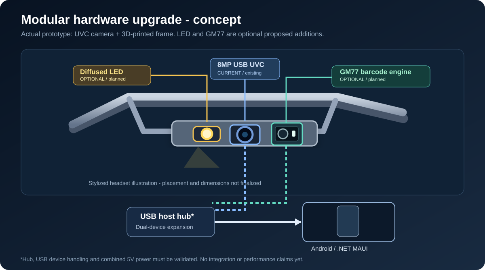
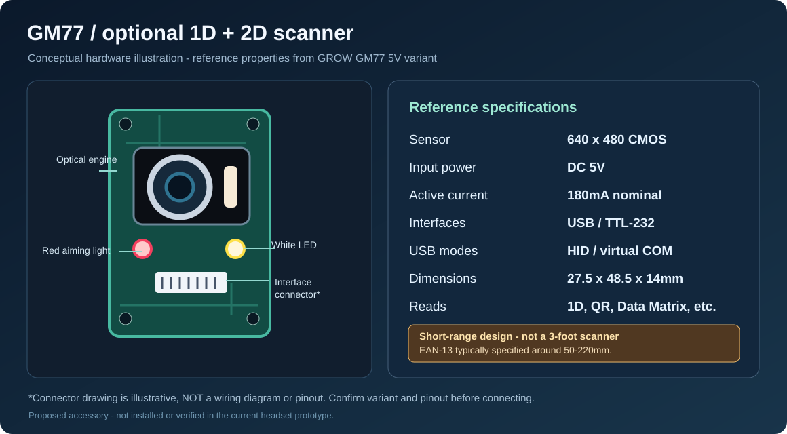
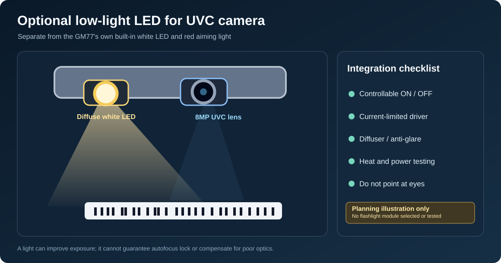

# Planned Hardware Expansion: LED Illumination and GM77 Barcode Engine

> **Status: design proposal / future enhancement — not part of the current working prototype or the hackathon demo.**
> The existing Meta Muse Vision AI headset uses an 8MP autofocus UVC USB camera with an Android/.NET MAUI app and Meta Muse Spark AI. This document describes **optional** additions; it does not claim either accessory has been mounted, wired, integrated into Android, or independently performance-tested on the headset.

## Concept illustrations



| Proposed GM77 barcode module (illustration) | Proposed auxiliary white LED (illustration) |
| :---: | :---: |
|  |  |

*These are original conceptual diagrams, **not photographs of installed hardware**. Refer to the [GROW GM77 manufacturer page](https://en.hzgrow.com/product/186.html) for photos and the exact reference module design.*

## Why consider these upgrades?

- **Auxiliary white LED:** a controllable, diffused light source adjacent to the existing UVC camera may improve exposure and reduce motion blur in low-light barcode, label, and counting tasks. It does not guarantee autofocus sharpness, and excessive or direct illumination can create glare on glossy packages.
- **Optional GM77 scanner engine:** a dedicated embedded decoder can read common 1D/2D symbols, potentially reducing dependence on general-purpose camera image analysis for *close-range* barcode reads. Preserve the original UVC camera and Muse AI image-analysis workflow for broader visual tasks.
- **Modular design:** users who only need visual AI should not need to purchase or wear the separate barcode engine.

## Candidate barcode engine: GROW GM77 (SLQZT-listed 5V USB/UART version)

| Parameter | Manufacturer specification (reference) |
| --- | --- |
| Module family | GM77 1D/2D barcode scanner; verify the exact seller SKU and board revision |
| Image sensor / decode engine | 640 × 480 CMOS |
| Supported examples | EAN/UPC, Code 39, Code 128, QR, Data Matrix, PDF417, Aztec |
| Electrical input | **DC 5V** for the standard GM77 |
| Operating current | **Approximately 180mA** during operation (scanner only; nominal 0.9W at 5V) |
| Standby current | Approximately 50mA (USB) / 10mA (TTL), manufacturer reference |
| Interfaces | USB HID keyboard / USB virtual COM; TTL-232 UART |
| Reference dimensions | 27.5 × 48.5 × 14mm |
| Built-in lighting | White illumination LED **and** red aiming LED |
| Typical 13-mil EAN-13 read range | Approximately **50–220mm** per GROW documentation; depends on code, size and conditions |

**Distance limitation:** the GM77 is a **short-range barcode decoder**; it is not a replacement for the existing headset's approximately 3-foot demonstration target. For example, a specified 220mm EAN-13 maximum is about 8.7 inches. Other barcode types have different ranges. The manufacturer's operating range is not an accuracy guarantee in this headset.

**Variant caution:** GROW lists a different **GM77-S at 3.3V**. The details above apply to the standard **5V GM77** and must not be applied blindly to another revision. Verify the purchased board and manufacturer's actual wiring documentation before applying power.

Manufacturer references:
- [GROW GM77 product/specification page](https://en.hzgrow.com/product/186.html)
- [DFRobot GM77 product and documentation](https://www.dfrobot.com/product-2480.html)

## Separate UVC camera illumination

The GM77 already has its own illumination. The **proposed separate light is intended for the existing 8MP UVC camera**, which is used for general visual processing.

Initial design criteria (not a selected part):
1. Small, diffused white LED aimed *downward at the work area*, not into the user's or other people's eyes.
2. Switchable by a properly rated driver or USB-controllable accessory. Do **not** wire a bare LED directly to 5V without a current-limiting circuit.
3. Keep it away from the autofocus lens to reduce direct reflections and flare.
4. Evaluate skin-contact temperature, power draw, cable strain relief and 3D-printed mounting clearance.
5. Capture matched before/after samples to measure whether illumination improves sharpness or first-pass success.

No specific LED model, electrical schematic, brightness, operating current or measured benefit has been validated.

## Integration options: Android and USB host

The **current UVC preview remains the primary camera**. The GM77 should be treated as a separate barcode-decoding device, **not** a second generic UVC video camera: its USB interface is documented as HID keyboard / virtual COM, not an advertised raw-video UVC feed.

Possible architecture:

```text
Android phone USB-C host
   |
   +-- USB hub (required if both USB peripherals share the one port; verify power)
         |
         +-- Existing 8MP UVC camera --> Android preview --> capture --> Meta Muse Spark
         |
         +-- Optional GM77 5V USB decoder --> Android HID or serial read --> barcode result

Optional diffused white LED --> separately rated power and switch/control arrangement
```

- **USB route is preferable for a modular prototype** if the purchased GM77 is USB-enabled. A hub with sufficient 5V current and compatible Android USB-host handling must be tested with *both* devices operating.
- **USB HID keyboard mode:** may act as keystrokes and inject input into the focused field. A robust app needs explicit capture of input, terminator handling, and suppression of unintended typing. Consider USB virtual COM mode if accessible and practical on the actual Android device.
- **UART route:** needs an appropriate UART host interface or USB-to-UART bridge; **do not connect UART signals to USB D+ / D−**, and verify the GM77's actual signal voltage and pinout before wiring.
- **Power budget:** GM77 reference current alone is ~180mA at 5V, *in addition to* the current UVC camera, hub overhead, and any separate LED. Phone OTG power capacity is device-specific; an externally powered hub may be required.
- **Behavior:** route the GM77-decoded text into the existing scanning workflow as a distinct source, validate the symbology/value, and deduplicate repeated automatic scans so a barcode is not accidentally added to the cart multiple times. Barcode text from either input should not be represented as an AI-generated interpretation.
- **Fallback logic:** the app may optionally try dedicated barcode decode for close-range codes when UVC capture is blurry, but do not assume the GM77 will work at a long camera-to-object distance.

No source code has been changed as part of this documentation update.

## Validation plan before calling this a working feature

| Test | Record |
| --- | --- |
| USB enumeration and power | GM77 identification, hub compatibility, total current, disconnect/reconnect |
| Scanner decode | 1D and QR tests, correct exact payload, first-pass vs eventual success |
| Working distance | Distance for each code type, with specific attention to the GM77's short range |
| Dual operation | UVC preview stays stable while GM77 decodes, including app reopen |
| LED on/off | Sharpness, glare, exposure, heat, and ambient-light changes |
| Hands-free comfort | Added weight, cable snagging, eye exposure, comfort during longer wear |
| Cart integration | Correct count, no duplicate automatic scans, failure handling |

**Existing user-reported benchmark:** 25 different barcodes were recognized with the current camera-based headset, with some requiring rescanning when the image was blurry. This is self-reported preliminary testing; no first-pass accuracy percentage or GM77 test result should be inferred from it.

## Cost and product positioning

The README's ~$45–$50 estimate applies **only to the existing base prototype**. The additional GM77 scanner, LED, USB hub/adapter, wiring, enclosure revision and validation costs are **not included**. Retain the current USB-powered modular design as the baseline and add optional modules only when measured benefits justify added weight and cost.
